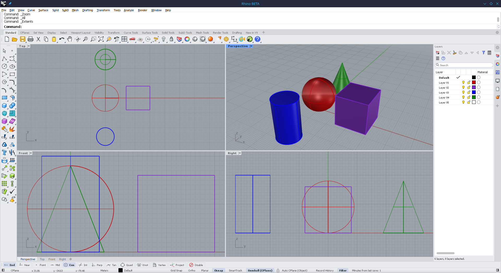
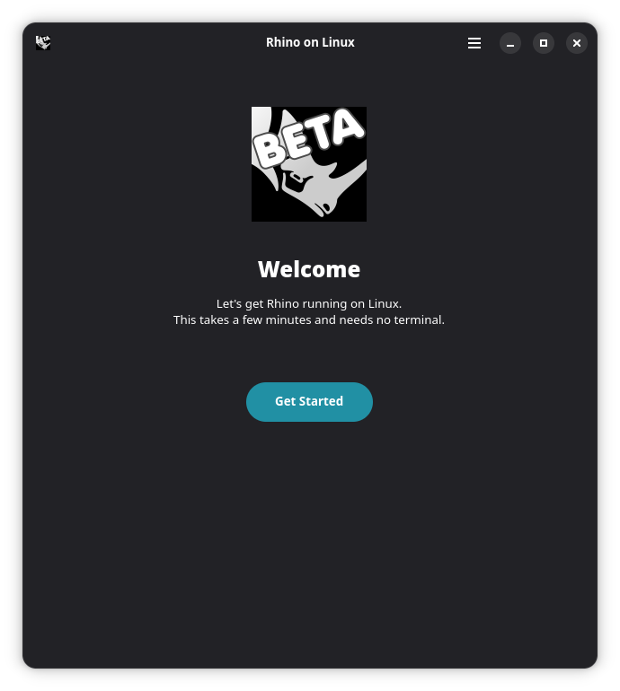
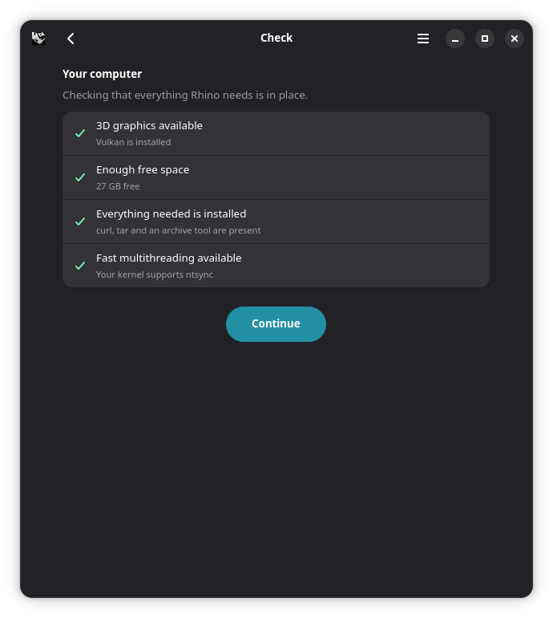
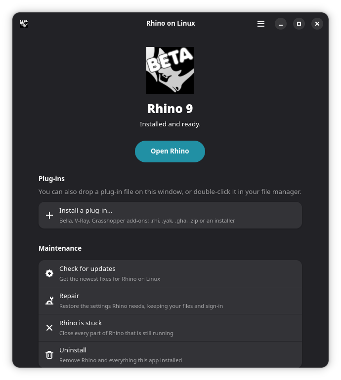
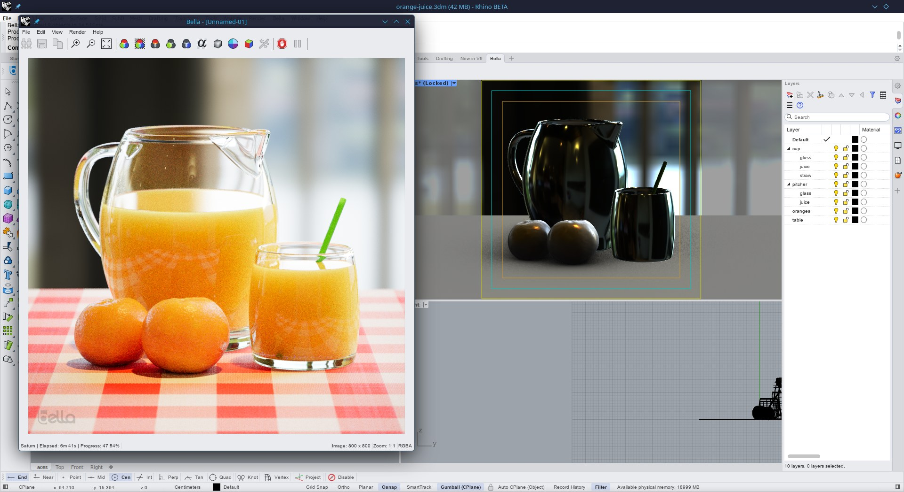

# Rhino on Linux

Patches and scripts to get McNeel Rhinoceros running on Linux using Wine and DXVK.



## Quickstart

```bash
git clone https://github.com/Jabern/rhino-linux.git
cd rhino-linux
./install.sh
```

`./install.sh` automatically downloads our pre-built patched Wine runtime (~54 MB) directly from GitHub Releases, so you **do not** need to compile Wine from source.

The runtime works on any 64-bit Intel or AMD processor. It needs a Linux
distribution from 2023 or later (glibc 2.38 or newer), such as Ubuntu 24.04,
Fedora 39, Debian 13 or a current Arch. On older systems, like Ubuntu 22.04 or
Debian 12, use the [Flatpak](#as-a-flatpak) instead: it brings its own system
libraries. You can check your version with `ldd --version`.

To run your Rhino installer directly, pass `--installer`:

```bash
./install.sh --installer /path/to/rhino_installer.exe
```

After install, launch it with:

```bash
rhino-9

# or open a model directly:
rhino-9 model.3dm
```

### Rhino 7, 8 and 9 side by side

Install as many versions as you like; run `./install.sh --installer` once per
installer. The version is read from the installer's name
(`rhino_en-us_8.36….exe` is Rhino 8), or pass `--version 7`, `8` or `9`.

Each version gets its own Windows environment (`~/.wine-rhino7`,
`~/.wine-rhino8`, `~/.wine-rhino9`), sharing one Wine runtime, so they never
interfere and each can be repaired or removed on its own. A prefix from an
earlier release is kept as the home of the version it already holds.

```bash
rhino-9                  # the newest installed Rhino
rhino-9 --version 8      # Rhino 8; rhino-8 and rhino-7 do the same
rhino-9 --stop           # close every Rhino that is running
```

Rhino 7 runs on Microsoft's .NET Framework 4.8 instead of the .NET that Rhino 8
and 9 ship with. The installer sets it up first with
[winetricks](https://github.com/Winetricks/winetricks), which makes Rhino 7's
first installation take 30 to 60 minutes. That part comes from
[Rhino7-Linux](https://github.com/JonasPedrotti/Rhino7-Linux).

## Prefer not to use the terminal?

**Rhino on Linux** is a small app that installs Rhino for you and looks after it
afterwards. It checks your computer, asks for the Rhino installer you downloaded
from McNeel, and shows the installation as it goes. You never have to open a
terminal.

<p align="center">
  
  
  
</p>

Once Rhino is installed, the app is where you go to:

- open Rhino, or one of several versions installed side by side
- install another version (Rhino 7, 8 or 9)
- install plug-ins (see below)
- check for updates
- repair the setup if something breaks, without losing your files or sign-in
- close Rhino when it is stuck
- uninstall everything it installed

Turn on *Expert mode* in the menu if you want the Wine side of things:
winecfg, the registry editor, the DXVK settings and the prefix folder.

### As a Flatpak

The Flatpak works the same on every distribution and brings everything the
app needs with it. You only need Flatpak and the Flathub remote, which most
desktop distributions set up already.

Download [RhinoOnLinux.flatpak](https://github.com/Jabern/rhino-linux/releases/latest/download/RhinoOnLinux.flatpak)
and double-click it. Your software center (GNOME Software, Discover) installs
it, along with the GNOME runtime it needs from Flathub.

If double-clicking opens nothing, your software center may not handle
downloaded Flatpak files. Shelly on CachyOS, for example, shows its normal
package list when its Flatpak support is switched off in its settings.
Installing from a terminal always works:

```bash
flatpak install --user ~/Downloads/RhinoOnLinux.flatpak
```

The download doesn't update itself. When a new version comes out, download it
again and install it over the old one; Rhino and your settings stay.

To build it yourself from this repository instead:

```bash
flatpak install --user flathub org.flatpak.Builder
flatpak run org.flatpak.Builder --user --install --install-deps-from=flathub \
    --force-clean build-flatpak flatpak/io.github.jabern.RhinoOnLinux.yml
```

Either way, open **Rhino on Linux** from your applications menu. Rhino gets its own
entry there too, and double-clicking a `.3dm` file opens it in Rhino.

The Flatpak keeps Rhino and its Wine setup in
`~/.var/app/io.github.jabern.RhinoOnLinux/`, separate from a regular install.
**Uninstall** in the app removes Rhino;
`flatpak uninstall --delete-data io.github.jabern.RhinoOnLinux` removes the app
and everything with it. It can see your home folder, so you can open and save
models wherever you keep them.

### Without Flatpak

Run the app straight from the downloaded folder with
`python3 tools/rhino-on-linux.py`. After the first installation it also shows up
in your applications menu. It runs the same scripts as the command line, so
both ways give you the same result.

This needs Python with GTK 4 and libadwaita 1.5 or newer (Ubuntu 24.04, Fedora 40
and current Arch have it):
- **Arch / Manjaro**: `sudo pacman -S --needed python-gobject gtk4 libadwaita`
- **Ubuntu / Debian**: `sudo apt install python3-gi gir1.2-gtk-4.0 gir1.2-adw-1`
- **Fedora**: `sudo dnf install python3-gobject gtk4 libadwaita`

## Installing plug-ins

Rhino's own Package Manager (`_PackageManager` inside Rhino) lists many
plug-ins. For the ones you download yourself, use **Install a plug-in…** in the
app, drop the file on its window, or double-click the file in your file manager.
The app knows these files:

| File | What happens |
|---|---|
| `.rhi` | McNeel's Rhino Installer Engine installs it, the same tool Windows uses |
| `.yak` | Rhino's package manager installs it from the file |
| `.gha`, `.ghuser` | copied into Grasshopper's Libraries or UserObjects folder |
| `.exe`, `.msi` | the plug-in's own installer runs, inside Rhino's Wine prefix |
| `.zip` | unpacked first, then installed as above |

Close Rhino before installing. If it is still open, the app offers to close it
for you. From the terminal, the same thing is
`tools/install-plugin.sh bella_rhino-26.4.0-win32.zip`.

Here is the [Bella](https://bellarender.com) renderer, installed from its
download `.zip` and rendering its sample scene:



Some plug-ins won't work under Wine: anything that installs a Windows driver,
such as a USB license dongle. Bella renders on the CPU, so it isn't affected.

## GPU rendering on NVIDIA

Rhino Render and the Raytraced display mode (Cycles) render on NVIDIA GPUs
through CUDA. When the setup finds the NVIDIA driver, it adds `nvcuda` from
[nvidia-libs](https://github.com/SveSop/nvidia-libs), which passes Rhino's CUDA
calls to the Linux driver. In Rhino, pick the GPU under **Options > Cycles**,
or with `RhinoCycles_SelectDevice`.

- Needs the proprietary NVIDIA driver; the Flatpak gets CUDA from its NVIDIA
  driver extension.
- OptiX is not enabled yet: the Raytraced viewport stays at "Uploading" with it.
- To skip this step, run the setup with `RHINO_NO_CUDA=1`.

## Dependencies

### Runtime Dependencies
Make sure you have Vulkan drivers and DXVK installed:

- **Arch / Manjaro**:
  ```bash
  sudo pacman -S --needed wine vulkan-icd-loader vulkan-headers dxvk-bin libx11 freetype2 gnutls
  ```
- **Ubuntu / Debian**:
  ```bash
  sudo apt update && sudo apt install -y wine64 libvulkan1 vulkan-tools libx11-6 libfreetype6 libgnutls30 dxvk
  ```
- **Fedora**:
  ```bash
  sudo dnf install -y wine vulkan-loader libX11 freetype gnutls dxvk
  ```
- **openSUSE**:
  ```bash
  sudo zypper install -y wine vulkan libX11 freetype2 libgnutls dxvk
  ```

### Build Dependencies (Optional)
Only required if you choose to compile Wine from source with `--build-wine` (requires `bison`, `flex`, `gcc`, `mingw-w64`, X11 dev headers).

## What the patches do

Stock Wine experiences crashes, blank web panels, and visual glitches when running Rhino. We maintain 21 targeted patches to resolve these issues across all major subsystems:

- **Compute & Stability**: Adds 64-bit dynamic OpenMP loop scheduling ([Patch 01](patches/01-vcomp-dynamic-init-next-i8.patch)), NT thread pool worker caps ([Patch 02](patches/02-ntdll-threadpool-worker-leak.patch)), and CPU affinity APIs ([Patch 03](patches/03-set-thread-ideal-processor-ex.patch)).
- **Cloud Zoo & Licensing**: Implements DirectComposition visual tree swapchain hosting for Microsoft Edge WebView2 ([Patch 06](patches/06-wine-dcomp-webview2-visual-hosting.patch), [Patch 07](patches/07-wine-dcomp-hidden-target-guards.patch)), ECDSA P-256 JWT auth ([Patch 15](patches/15-wine-ncrypt-ecdsa-p256.patch)), and Session 0 RPC services ([Patch 13](patches/13-wine-services-session0.patch)).
- **UI Chrome & Popups**: Fixes 32bpp depth matching and alpha-blended menu icons ([Patch 04](patches/04-wine-x11-layered-and-depth-match.patch), [Patch 05](patches/05-wine-menu-alpha-blend.patch)), layered child panels ([Patch 08](patches/08-wine-layered-child-windows.patch)), Task Dialogs ([Patch 14](patches/14-wine-comctl32-taskdialog.patch)), and `RhinoGreet` startup window visibility ([Patch 17](patches/17-rhino-greet-x11-startup.patch)).
- **Viewport & Graphics**: Rebinds X11 client surfaces and forces redraws on Vulkan swapchain recreation to eliminate viewport maximize black bars ([Patch 18](patches/18-x11-client-surface-repaint.patch)), plus DXGI format fallback ([Patch 11](patches/11-wine-dxgi-unknown-swapchain-format.patch)).
- **Multi-Monitor & Wayland**: Excludes MDI child windows from multi-monitor desktop offset shifts ([Patch 19](patches/19-wine-multimonitor-child-maximize.patch)), anchors XRandR coordinates to prevent Wayland mouse drift ([Patch 20](patches/20-wine-xrandr-primary-anchor.patch)), and adds Wayland popup overlay compositing ([Patch 16](patches/16-winewayland-popups-and-overlays.patch)).

See [docs/patches.md](docs/patches.md) for the detailed technical breakdown and file lists for all patches.

## Desktop Environments & Window Managers

- **Recommended**: **KDE Plasma** or **GNOME**. Stacking desktop environments handle multi-window CAD applications, floating palettes, middle-click popups, and multi-monitor setups out of the box with zero configuration.
- **Tiling Window Managers (Niri, Hyprland, Sway)**: Supported with custom window rules. See [docs/tiling-window-managers.md](docs/tiling-window-managers.md) for required floating rules and configuration snippets.

## Building Wine manually

If you prefer building Wine yourself instead of running `./install.sh`:

```bash
# 1. Clone Wine
git clone https://gitlab.winehq.org/wine/wine.git ~/src/wine
cd ~/src/wine
git checkout wine-11.18

# 2. Apply patches
for p in /path/to/rhino-linux/patches/{0[1-9],1[0-5],1[7-9],2[0-9]}-*.patch; do
    patch -p1 < "$p"
done

# 3. Build Wine 64-bit
mkdir ~/src/build-wine && cd ~/src/build-wine
../wine/configure --enable-win64 --prefix=/opt/wine-rhino --without-capi
make -j$(nproc)
sudo make install

# 4. Configure prefix
cd /path/to/rhino-linux
./tools/deploy-rhino.sh --prefix ~/.wine-rhino --wine /opt/wine-rhino/bin/wine
```

## Credits & Acknowledgements

- Thanks to [ItHasLegs](https://github.com/ItHasLegs/rhino8-wine) for researching the early `uxtheme` dark-mode crash (now upstream in Wine 11.14) and for the `--fresh` wineserver restart concept to clear stale HTTP state for Cloud Zoo OAuth licensing.
- Thanks to [eqeka](https://github.com/eqeka) for testing, and for tracking down the straight Grasshopper wires (fixed in Patch 21) and the Grasshopper menu focus issue on Niri.

## License

- Patches in `patches/` follow Wine's LGPL 2.1+ license.
- Scripts and configs are MIT.
