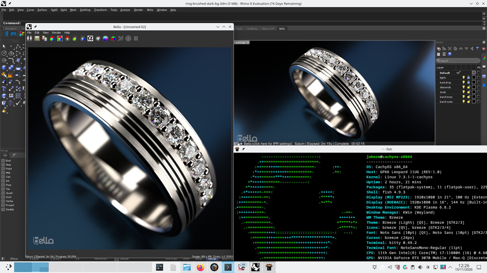
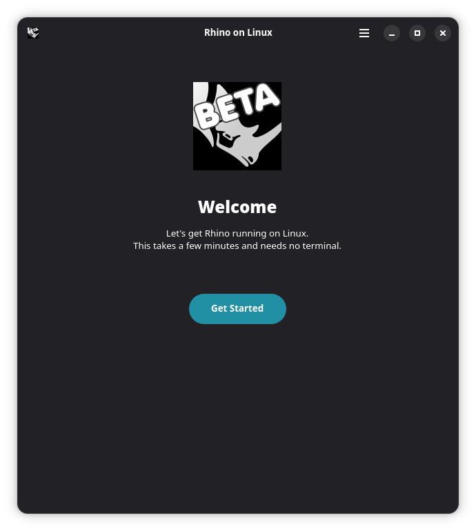
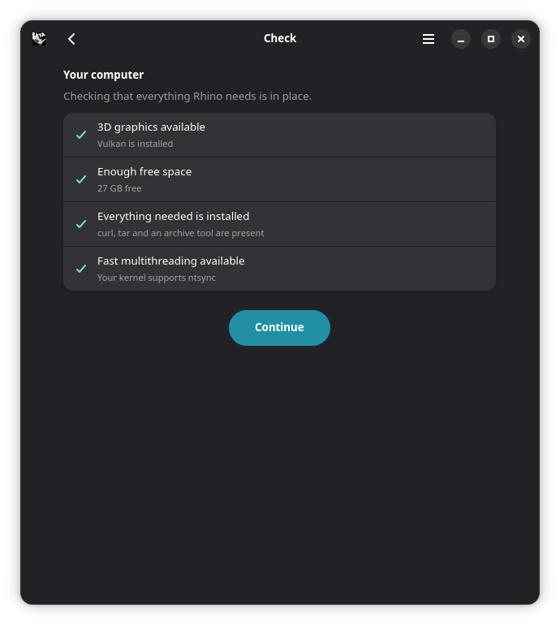
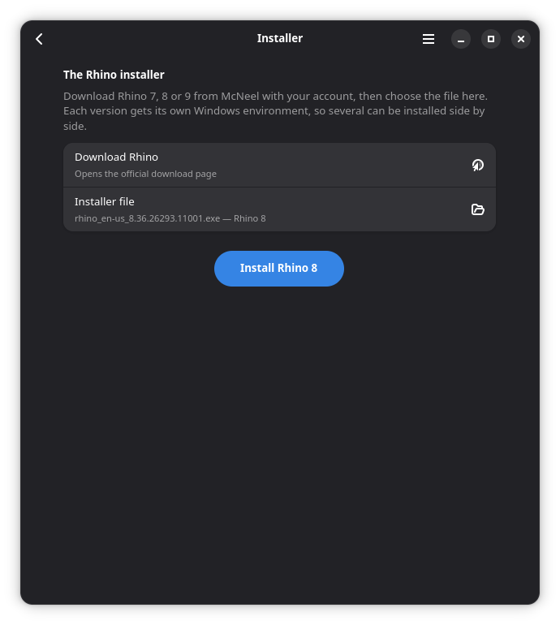
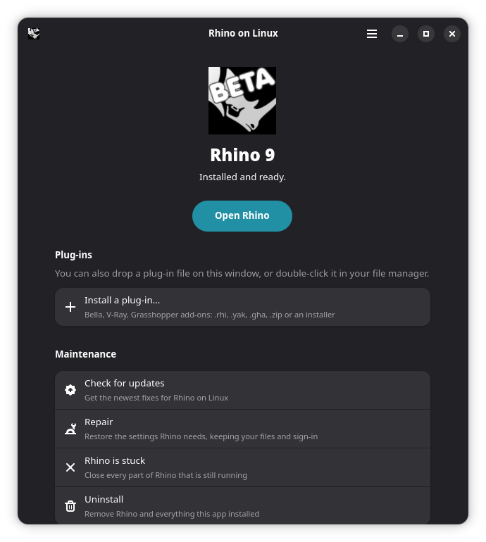

# Rhino on Linux

Run McNeel's **Rhinoceros 7, 8 and 9** on Linux, with hardware-accelerated
viewports, Cloud Zoo sign-in, plug-ins and GPU rendering. Rhino on Linux sets up
a patched [Wine](https://www.winehq.org) for Rhino and looks after it for you.



*Rhino 8 on CachyOS with KDE Plasma, rendering Bella's ring sample scene with the Bella plug-in.*

## What you need

- **A Rhino installer and license** from McNeel. Download the Windows installer
  (`rhino_en-us_8….exe`) from [rhino3d.com](https://www.rhino3d.com/download/);
  the evaluation works too.
- **A 64-bit Intel or AMD computer** with a graphics card and driver that support
  Vulkan (NVIDIA, AMD or Intel).
- **About 8 GB of free space** per Rhino version.
- **Any desktop Linux.** KDE Plasma, GNOME and Cinnamon (Linux Mint) work out of
  the box; tiling window managers need [a few window rules](docs/tiling-window-managers.md).

## Install

### The easy way: the app

1. Download [**RhinoOnLinux.flatpak**](https://github.com/Jabern/rhino-linux/releases/latest/download/RhinoOnLinux.flatpak).
2. Double-click it. Your software center (GNOME Software, Discover, …) installs it.
3. Open **Rhino on Linux** from your applications menu, click **Get Started**,
   and pick the Rhino installer you downloaded. The app checks your computer,
   installs Rhino and shows its progress. You never need a terminal.

<p align="center">
  
  
  
  
</p>

If double-clicking the file opens nothing, install it from a terminal instead,
either from the download or straight from our signed Flatpak repository:

```bash
flatpak install --user ~/Downloads/RhinoOnLinux.flatpak
# or
flatpak install --user https://jabern.github.io/rhino-linux/rhino-on-linux.flatpakref
```

The Flatpak brings everything it needs and works the same on every
distribution, old or new.

### From a terminal

```bash
git clone https://github.com/Jabern/rhino-linux.git
cd rhino-linux
./install.sh --installer ~/Downloads/rhino_en-us_8.xx.exe
```

`install.sh` downloads our pre-built Wine runtime (about 55 MB) from GitHub
Releases, so nothing is compiled. Add `--deps` to have it install the system
packages it needs (Vulkan, cabextract, …) with your package manager.

The pre-built runtime needs a distribution from 2023 or later (glibc 2.38 or
newer: Ubuntu 24.04, Fedora 39, Debian 13, current Arch, Linux Mint 22). On older
systems such as Ubuntu 22.04 or Debian 12, use the Flatpak. `ldd --version`
shows your glibc version.

You can also run the app without Flatpak, straight from this folder, with
`python3 tools/rhino-on-linux.py`. It needs Python with GTK 4 and libadwaita 1.5
or newer:
- **Arch / Manjaro**: `sudo pacman -S --needed python-gobject gtk4 libadwaita`
- **Ubuntu / Debian / Mint**: `sudo apt install python3-gi gir1.2-gtk-4.0 gir1.2-adw-1`
- **Fedora**: `sudo dnf install python3-gobject gtk4 libadwaita`

## Using Rhino

Open **Rhino** from your applications menu, or double-click a `.3dm` file. You
open and save models anywhere, on any drive, as on Windows. From a terminal:

```bash
rhino-linux                 # the newest installed Rhino
rhino-linux model.3dm       # open a model
rhino-linux --version 8     # a given version (rhino-7, rhino-8, rhino-9 do the same)
rhino-linux --stop          # close every Rhino that is running
```

With the Flatpak, the same commands are
`flatpak run --command=rhino-linux io.github.jabern.RhinoOnLinux …`.

### Rhino 7, 8 and 9 side by side

Install as many versions as you like: **Install another Rhino version** in the
app, or `./install.sh --installer` once per installer. Each version gets its own
Windows environment, so they never interfere, and each can be repaired or removed
on its own. Rhino 7 runs on Microsoft's .NET Framework 4.8, which makes its first
installation take 30 to 60 minutes.

## Settings

The app's home page has a few settings. Each one also works as a variable when
starting Rhino from a terminal, for example `RHINO_SCALE=150 rhino-linux`.

| Setting | What it does | Variable |
|---|---|---|
| **Interface size** | Rhino's menus, toolbars and panels at 100 to 200 %, as Windows' display scaling, for large or high-resolution screens | `RHINO_SCALE=150` |
| **Windows colors** | **Dark** makes the menus, message boxes and file dialogs dark too, to go with Rhino's dark mode (Options › Appearance) | `RHINO_COLORS=dark` |
| **Graphics card** | with several graphics cards, the one Rhino draws with (it can hang at its start screen on the wrong one) | `RHINO_GPU=4080` (part of its name) |
| **OpenGL** | your driver's own OpenGL, or [Zink](https://docs.mesa3d.org/drivers/zink.html) (Mesa's OpenGL on Vulkan) for the viewports of Rhino 7 and 8 | `RHINO_GL=zink` |

Settings apply from Rhino's next start. Turn on *Expert mode* in the app's menu
for the Wine side of things: winecfg, the registry editor, the DXVK settings and
the prefix folder.

## Plug-ins

Rhino's own Package Manager (`_PackageManager` in Rhino) works as on Windows. For
plug-ins you download yourself, use **Install a plug-in…** in the app, drop the
file on its window, or double-click it in your file manager:

| File | What happens |
|---|---|
| `.rhi` | McNeel's Rhino Installer Engine installs it, the same tool Windows uses |
| `.yak` | Rhino's package manager installs it from the file |
| `.gha`, `.ghuser` | copied into Grasshopper's Libraries or UserObjects folder |
| `.exe`, `.msi` | the plug-in's own installer runs, inside Rhino's Windows environment |
| `.zip` | unpacked first, then installed as above |

Close Rhino before installing; the app offers to close it for you. From a
terminal: `tools/install-plugin.sh bella_rhino-26.4.0-win32.zip`.

The picture at the top is [Bella](https://bellarender.com), installed this way from
its download `.zip`. Plug-ins that install a Windows driver, such as a USB license
dongle, don't work under Wine.

### 3Dconnexion SpaceMouse

Tested with a SpacePilot Pro by alexander_rollay on the McNeel forum:

1. In Rhino, run `PlugInManager`, click **Install…** and pick
   `C:\Program Files\Rhino 8\Plug-ins\3dxrhino.rhp` (your Rhino version's folder).
2. Linux also treats the SpaceMouse as a mouse, so the cursor drifts while you
   navigate. Find its vendor and product ids with `lsusb | grep -i 3Dconnexion`
   (for example `046d:c629`), and tell Linux to leave it to Rhino:

   ```bash
   echo 'ACTION=="add|change", KERNEL=="event*", ATTRS{idVendor}=="046d", ATTRS{idProduct}=="c629", ENV{LIBINPUT_IGNORE_DEVICE}="1"' \
       | sudo tee /etc/udev/rules.d/99-spacemouse-ignore-mouse.rules
   sudo udevadm control --reload-rules && sudo udevadm trigger
   ```

   Then unplug the SpaceMouse and plug it back in.

## Updating and uninstalling

**Update** in the app, your software center or `flatpak update` brings new
versions, signed by this project. Versions 1.4.1 and older, installed from a
downloaded file, have no update source yet: **Update** in the app downloads the
new version once, and later updates come by themselves. Without Flatpak, run
`git pull` and `./install.sh` again.

**Uninstall** in the app removes Rhino and everything it installed.
`flatpak uninstall --delete-data io.github.jabern.RhinoOnLinux` removes the app
too. The Flatpak keeps Rhino and its Windows environments in
`~/.var/app/io.github.jabern.RhinoOnLinux/`; a terminal install keeps them in
`~/.wine-rhino7`, `~/.wine-rhino8` and `~/.wine-rhino9`.

## Troubleshooting

- **Something broke after an update or a crash**: **Repair** in the app sets
  up Rhino's Windows environment again, without losing your files, settings or
  sign-in.
- **Rhino hangs at its start screen** on a computer with several graphics cards:
  choose the card your monitor is connected to under **Graphics card**.
- **Rhino is stuck or won't open again**: **Close Rhino** in the app, or
  `rhino-linux --stop`.
- **Cloud Zoo sign-in doesn't come back to Rhino**: start Rhino with
  `rhino-linux --fresh`.
- **Viewports freeze for a few seconds on NVIDIA**: a driver fault (`Xid 109` in
  `journalctl -k`); NVIDIA's own OpenGL recovers from it, Zink doesn't, which is why
  Zink isn't the default.
- **Still stuck?** Ask in the
  [McNeel forum thread](https://discourse.mcneel.com/t/rhino-on-linux/8820) or
  [open an issue](https://github.com/Jabern/rhino-linux/issues), with your
  distribution, desktop, graphics card and Rhino version.

## GPU rendering on NVIDIA

Rhino Render and the Raytraced display mode (Cycles) render on NVIDIA GPUs with
CUDA or OptiX. When the setup finds the NVIDIA driver, it adds `nvcuda` and
`nvoptix` from [nvidia-libs](https://github.com/SveSop/nvidia-libs), which pass
Rhino's calls to the Linux driver. In Rhino, pick the GPU under
**Options › Cycles**.

- Needs the proprietary NVIDIA driver; the Flatpak gets CUDA and OptiX from its
  NVIDIA driver extension.
- The first Raytraced start on OptiX shows "Uploading" for about half a minute
  while the driver compiles its kernels; later starts are quick.
- To skip this step, run the setup with `RHINO_NO_CUDA=1`.

### AMD and Intel GPUs (testing)

Rhino's Cycles also renders on AMD GPUs (HIP, Vega and newer) and Intel Arc GPUs
(oneAPI). The runtime brings [bridges](gpu-bridges/README.md) that pass these calls to
the Linux drivers. They need the vendor's compute runtime installed on your system
(not yet in the Flatpak):

- **AMD**: ROCm's HIP runtime (`libamdhip64.so.6` or `.7`), for example the `rocm-hip-runtime`
  or `hip-runtime-amd` package.
- **Intel Arc**: the Level Zero loader and Intel's compute runtime (`level-zero-loader`
  and `intel-compute-runtime`, or `libze1` and `intel-opencl-icd` on Ubuntu).

They are new and not yet confirmed on real cards, so turn them on yourself:

```bash
RHINO_GPU_BRIDGES=1 rhino-linux
```

Then pick the GPU under **Options › Cycles**. If you try it, please tell us how it
went in the [forum thread](https://discourse.mcneel.com/t/rhino-on-linux/8820) or an
[issue](https://github.com/Jabern/rhino-linux/issues), with your card and distribution.

## What the patches do

Stock Wine crashes, shows blank panels or misplaces windows with Rhino. This
project keeps 48 patches for Wine 11.20 (in [`patches/`](patches)), grouped here
by what they fix:

- **Stability and speed**: OpenMP loop scheduling, thread pools, CPU affinity,
  COM services, faster start (Rhino 8 ready in about 6 s instead of 12.6 s).
- **Cloud Zoo, licensing and the Script Editor**: WebView2 with GPU
  DirectComposition, ECDSA sign-in keys, Session 0 services, HTML dialogs.
- **Windows and menus**: layered and alpha-blended windows, task dialogs, the
  start screen, popups, focus, maximizing and window placement under KWin,
  Mutter and Cinnamon.
- **Viewports**: Vulkan and OpenGL surfaces that redraw on resize without black
  frames, antialiasing on NVIDIA, smooth frame pacing under Xwayland, raster
  printing (Rhino 5).
- **Multi-monitor and Wayland**: monitor offsets, pointer drift, Wayland popups.

[docs/patches.md](docs/patches.md) explains each patch, and
[patches/README.md](patches/README.md) lists them all.

### Building Wine yourself

`./install.sh --build-wine` compiles Wine with the patches instead of downloading
it (needs `bison`, `flex`, `gcc`, `mingw-w64` and the X11 development headers).
By hand:

```bash
git clone --branch wine-11.20 https://gitlab.winehq.org/wine/wine.git ~/src/wine
cd ~/src/wine
# every patch except 16, which is for Wine's Wayland driver only
for p in /path/to/rhino-linux/patches/{0[1-9],1[0-5],1[7-9],[2-9][0-9]}-*.patch; do patch -p1 < "$p"; done
mkdir ~/src/build-wine && cd ~/src/build-wine
../wine/configure --enable-win64 --prefix=/opt/wine-rhino --without-capi
make -j"$(nproc)" && sudo make install
cd /path/to/rhino-linux
./tools/deploy-rhino.sh --prefix ~/.wine-rhino8 --wine /opt/wine-rhino/bin/wine
```

To build the Flatpak from this repository:

```bash
flatpak install --user flathub org.flatpak.Builder
flatpak run org.flatpak.Builder --user --install --install-deps-from=flathub \
    --force-clean build-flatpak flatpak/io.github.jabern.RhinoOnLinux.yml
```

## Credits & Acknowledgements

- Thanks to [ItHasLegs](https://github.com/ItHasLegs/rhino8-wine) for researching the early `uxtheme` dark-mode crash (now upstream in Wine 11.14) and for the `--fresh` wineserver restart concept to clear stale HTTP state for Cloud Zoo OAuth licensing.
- Rhino 7's .NET Framework setup comes from [Rhino7-Linux](https://github.com/JonasPedrotti/Rhino7-Linux) by Jonas Pedrotti.
- [Zink](https://docs.mesa3d.org/drivers/zink.html), Mesa's OpenGL on Vulkan, started by Erik Faye-Lund and developed by Mike Blumenkrantz and the Mesa contributors, is available for the OpenGL viewports.
- [DXVK](https://github.com/doitsujin/dxvk) by Philip Rebohle and contributors runs Rhino's Direct3D, and [nvidia-libs](https://github.com/SveSop/nvidia-libs) by SveSop brings CUDA and OptiX to Rhino Render.
- Thanks to [eqeka](https://github.com/eqeka) for testing, and for tracking down the straight Grasshopper wires (fixed in Patch 21) and the Grasshopper menu focus issue on Niri.
- Thanks to [Gavin Metzler](https://github.com/gavinmetzler) for Patch 41 (antialiasing kept after a layout on NVIDIA) and Patch 42 (no focus stealing from the background), and for his testing and bug reports.
- Thanks to [krolaper](https://github.com/krolaper) for Patches 46 and 47 (Rhino 5 raster print preview) and for finding that the runtime was built without CUPS printing.
- Thanks to alexander_rollay for the 3Dconnexion SpaceMouse setup, and to the McNeel forum testers whose reports led to the 1.5 fixes.
- The ring scene in the picture at the top is one of [Bella's sample scenes](https://bellarender.com/scenes/).

## License

- Patches in `patches/` follow Wine's LGPL 2.1+ license.
- Scripts and configs are MIT.
